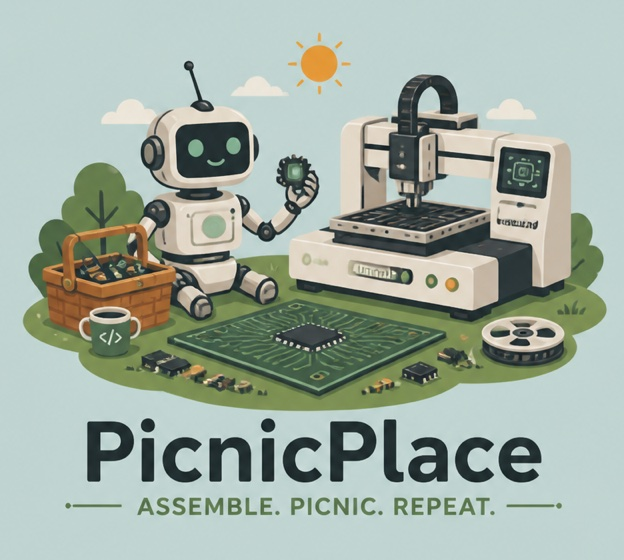

<p align="center">
  
</p>

# PicnicPlace

PicnicPlace is an open source software controller for automated PCB assembly
pick-and-place machines.

It is **network first**: a headless core runs the machine (motion, vision, feeders, and
jobs), and every user interface, including the modern PicnicPlace Studio GUI, connects to
it over a documented, versioned API. Closing a GUI never ends a running job, and
anyone can build their own client.

The reference hardware is the **Opulo LumenPnP v4**.

## Status

Early development (milestone M0). The core runs against a built-in machine simulator,
and the Studio GUI connects to it; real hardware support begins in M1. Start with the
[specification](docs/SPEC.md).

## Try it

Requires [uv](https://docs.astral.sh/uv/) and Node.js 22 or newer.

```sh
make setup
make core      # then open http://127.0.0.1:7420
```

That runs the built-in simulator. To exercise the real Marlin driver without a machine,
run it against a fake LumenPnP firmware, or point it at a real one:

```sh
cd core
uv run picnicd --studio-dir ../studio/dist --driver fake-marlin --profile lumenpnp-v4
uv run picnicd --studio-dir ../studio/dist --driver marlin --profile lumenpnp-v4 \
    --serial-port /dev/ttyACM0 --speed-scale 0.25
```

Bringing up a machine for the first time? Run the probe first. It never moves the
machine; it records the firmware's identity, endstops, settings, vacuum readings, and
cameras into a transcript, and prints a checklist for the first motion test:

```sh
uv run picnicplace-probe --serial-port /dev/ttyACM0 --with-pumps
```

See [CONTRIBUTING.md](CONTRIBUTING.md) for the development workflow.

## Planned stack

- **Core:** Python 3.12+, OpenCV, FastAPI, asyncio
- **GUI:** TypeScript web app, served by the core, optionally packaged as a desktop app
- **Platforms:** Linux for 1.0 (x86_64 and ARM64); macOS for development with the simulator

## License

PicnicPlace is licensed under the [Mozilla Public License 2.0](LICENSE). Changes to
PicnicPlace files must be shared under the same license. Separate add-ons and clients
that use the API may use any license.

Contributions are accepted under the
[Developer Certificate of Origin](https://developercertificate.org/): sign off your
commits with `git commit -s`.
