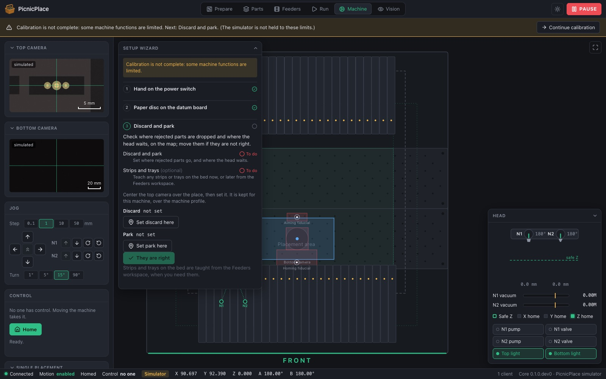
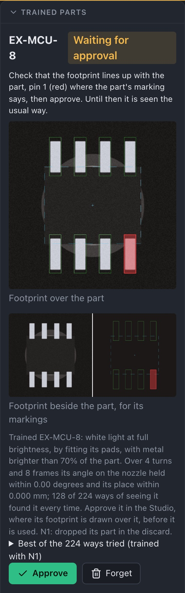
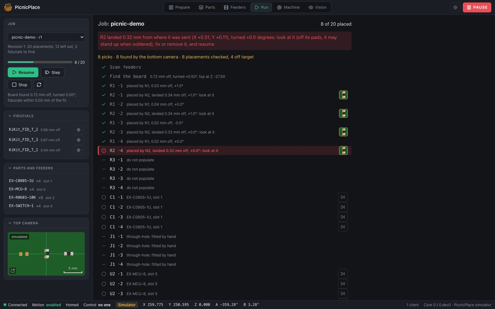
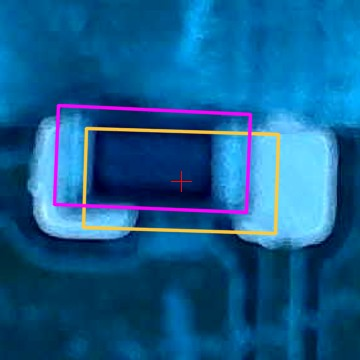

# Bring up a machine

!!! warning "Tested on one real machine so far"

    These steps have been run against the fake firmware and one real LumenPnP v4.1
    (homing, jogging, and board fiducials), and will be refined as more machines are
    brought up. The LumenPnP has no E-stop: keep a hand on its controller's power
    throughout (see [Stopping the machine](#stopping-the-machine-and-homing-safely)).
    STOP in the Studio waits for the current move to finish on its stock firmware.

PicnicPlace runs on Linux for real machines. These steps are for a LumenPnP v4.1 or v4.2
with stock firmware; other machines need their own machine profile.

## Stopping the machine, and homing safely

- **The emergency stop is the controller's power.** Unplugging the controller, or
  pressing the reset button on the LumenPnP's controller board, stops all motion at once.
  Keep a hand on the power cord whenever the machine moves: it also keeps your hands out of
  the machine. An E-stop switch that cuts the motors' power does the same and is worth
  fitting, but PicnicPlace does not require one. The Studio has no software emergency
  stop: Marlin acts on `M112` only after the move under way, then hangs until the
  controller is reset or power-cycled. **Pause** and **Stop** hold or end what the machine
  is doing once the move under way has finished.
- **Level the nozzles before homing.** On the LumenPnP both nozzles hang from one Z motor,
  and nothing on the machine can tell whether they are level until Z is homed. A nozzle
  hanging low can be dragged into feeders, boards or the bed as the head travels to its
  home switches. Every **Home** in the Studio, and the wizard's first **Start**, asks you
  to check first. A machine whose profile has a safe-Z sensor (`safe_z_input`) answers the
  question itself: when it reads safe, homing goes ahead without asking, and when it reads
  not safe, the machine will not home until you raise the nozzles by hand (unless its
  profile says it raises Z before X and Y move, `homes_z_first`). One is recommended,
  never required.
- **Z homes only at X/Y home.** The LumenPnP homes Z by lowering the left nozzle until the
  right one reaches the Z switch, and only at X/Y home is there open space under the
  nozzles; anywhere else, the left nozzle would hit the bed. The core homes only with the
  profile's whole home commands (`G28`), never Z alone. If you send G-code by hand, never
  send `G28 Z` away from X/Y home.

## 1. Start the core and open the wizard

Start the core (`uv run picnicd` in `core`) and open the Studio. Until a machine is
chosen it runs the built-in simulator: it says so when it starts, and the Studio's status
bar shows **Simulator**. A banner across the top says calibration is not complete;
**Continue calibration** opens the **Setup wizard** in the Machine workspace at the next
page. Each page says what it learns, what to do before it, and what will happen. You can
leave at any page and pick up there later.

What you choose in the wizard is kept in `machine-setup.json` in the core's data
directory. Anything set in a config file (`picnicd -c path/to/picnicd.toml`, see
[`core/picnicd.example.toml`](https://github.com/mfarver/picnicplace/blob/main/core/picnicd.example.toml))
or on the command line wins over it, and the wizard says so on that page.

## 2. Your machine and its serial port

- [ ] **Your machine** (page 2): choose LumenPnP v4.1 or v4.2, and **My machine, on a
      serial port**. (**Try it in the simulator** keeps the simulator, with that
      machine's layout.)
- [ ] **Connect** (page 3): plug the machine in, turn it on, close OpenPnP, and choose
      its port (on Linux, the stable `/dev/serial/by-id/` path if there is one).
      **Probe** asks the firmware what it is, and never moves anything or switches
      anything on. It shows the firmware and its version, the machine type (and whether
      it is what the profile expects), whether STOP can act in the middle of a move
      (Marlin's emergency parser), and which format the vacuum sensors read in.
- [ ] **Restart the core**. It comes back on the machine, and the Studio reloads. Until
      every page is done, every move runs at a quarter of full speed at most.

If the probe read the vacuum sensors only in the `vacuum-24bit` format, set
`variant = "vacuum-24bit"` under `[machine.marlin]` in a config file (the wizard does not
set it yet).

For a full transcript to share when asking for help, stop the core and run
`uv run picnicplace-probe --serial-port /dev/ttyACM0 --with-pumps` in `core`. It also
reads each nozzle's vacuum with its pump and valve on for about a second, and lists the
cameras with their video formats, sizes, and frame rates (on Linux, with nothing to
install).

## 3. Calibrate: three stops

The **Setup wizard** floats over the machine map in the Machine workspace (the banner's
**Continue calibration** opens it). It asks for you only where the machine cannot act or
check for itself: each stop says what to do, then one **Start** runs every step after it,
showing each as it runs and what it found. A step that fails stops the run and says what
to check. **Start** again skips the steps already done and still good (homing, if the
machine is homed), so it picks up where the last run stopped; once every page of a stop
is done, the button reads **Run again** and redoes them all. **Pause** (in the wizard,
or the top bar) lets the move under way finish, then holds the machine until **Resume**;
**Stop** ends the run there, with the machine still homed. Neither is an emergency stop:
for that, unplug the controller or press its reset button.
You can close the wizard and come back to it from any Studio: what the machine measures is
kept in `calibration.json` in the data directory, and the pages you confirm in
`wizard.json`.

{ .pp-screenshot }

1. **Nozzles level, hand on the power.** Fit the nozzle tips, empty, check the nozzles
   are level, keep a hand on the controller's power, and click **Start** (unless the
   machine is homed, it asks once more about the nozzles before homing). At a
   quarter of full speed, it:
    - homes. After homing, Z must read 0 with both nozzles level; if the firmware reports
      anything else, homing fails saying so (the LumenPnP profile sends `G92 Z0`, because
      its firmware calls level 31.5);
    - runs visual homing: finding the datum board's dot where the profile says confirms
      that X and Y move the right way and the top camera's picture is the right way
      around, and places the keep-outs, which are measured from the dot;
    - measures the top camera's scale (the line warns if it is more than 10% from the
      profile's);
    - calibrates the bottom camera with the left nozzle: it finds the tip by its hole,
      the darkest round mark near the middle (the nozzle's lit rings behind the tip are
      farther from the camera and move less as the head moves, which on one real LumenPnP
      made the scale half as large again; a tip with no hole seen is found by any round
      mark, as the profile's scale for the camera is only a guess), steps the head to measure the camera's real scale and
      how far its picture is turned, centers the tip, and steps the nozzle up and down
      for the sharpest picture, never more than 2 mm past the profile's focus height (the
      profile's, not the last one found, so repeated calibrations cannot creep toward the
      camera). A camera with a deep field is as sharp all through: then the profile's
      focus height is kept, and the line says so. It
      then finds the tip at 0° and 180°: the camera's place is the axis the nozzle turns
      about, halfway between, not the tip's end. A turned picture is undone in everything
      the bottom camera sees;
    - names the tip on each nozzle by the size of its end or of its dark hole, seen from
      below, with the hole seen inside: a lit ring behind a real tip's end can look like a
      larger tip's end, so a tip whose hole is not seen is not named, and you say which it
      is. A wide hole (5 mm or more, an N75's or N110's) is a cup, lit inside: it is named
      only if its end and hole are both its size and the cup is lit all through, and not
      if a tip with a dark hole fits too. A small tip whose end is lit no brighter than
      the cone behind it (an N045 or N08, under the stock ring light) is named by its
      dark hole alone, if only one tip's hole is that size. A nozzle that cannot reach
      the focus height (a short tip on a low nozzle) goes as low as its travel allows, if
      that is within 1 mm: the picture is about as sharp over that much;
    - scans the feeders and calibrates their rails, if there are feeders at each rail's
      ends (otherwise each feeder's fiducial is found on its first pick).
2. **Paper disc on the datum board.** Fit a small tip on each nozzle: a tip seals on the
   disc only with a millimeter of paper all round its face. A LumenPnP comes with one tip
   of each size, so fit a different one on each, such as the N045 on the left and the
   N08 on the right. If a tip is too big for the disc (an N24 on a LumenPnP's 4.9 mm
   disc), the head comes to the front with the nozzles up before anything goes down, and
   asks you to change it and say which tips are on. Lay a small paper disc (one that came with the machine, or from a hole
   punch) flat on the datum board, clear of its center dot, and click **Start**. The top
   camera looks over the board for it, in frames that overlap enough that a disc up to
   7 mm lies whole in one of them, starting where the disc was last found (or at the dot,
   the first time), and stops at the first frame that shows paper: a round mark as bright
   as paper, apart from the board's own marks around the dot. The search reaches 5 mm
   past the board's keep-out, but leaves
   out anything inside another keep-out, such as the bottom camera's ring light, whose
   LEDs are round and bright, and the datum board's own tinned pad and silkscreen disc,
   22.5 mm either side of the dot: each is 5 mm across, and as bright as paper. Each nozzle then sniffs for the board's height: with
   suction on, it steps down until the vacuum seals, never more than 1.5 mm below the
   profile's height. A big tip sniffs the disc, as paper seals it at a touch where bare
   board does not. A small tip (a face up to 1.5 mm, the N045 and N08) pulls the disc up
   from about a millimeter away, so it sniffs bare solder mask instead, in the middle of
   a square of the board's copper grid, clear of the disc, once the top camera sees the
   spot is bare: on a real LumenPnP it sealed there as soon as it touched. The same goes
   when only new tips' heights are measured on a paper square: a small tip touches bare
   board, and picks the paper up only to read its vacuum holding it. Then it picks the disc up, turns it, and sets it down three
   times, and the top camera finds it after each: suction comes on before the tip comes
   down, the nozzle waits there for the vacuum to say it holds the disc, and lifts the
   first millimeter slowly. A disc that never seals, and one that seals but drops as it
   lifts, are told apart. A nozzle more than a millimeter from
   the profile's offset is flagged. Where each nozzle touched the board corrects its
   heights from then on, and its vacuum readings (open, sealed, holding the disc) set its
   own pick threshold. A big tip can pull a light disc up too (a real N24 lifted a
   plastic punch from about a millimeter): if the disc seals on the first step down, the
   nozzle's height measured before with a small tip (or with this tip) is used, and the
   line says so; with none known, the stop asks you to check the height. Each tip's heights and vacuum levels are kept, and come back when
   that tip is fitted again; a tip not measured yet marks this stop out of date.

   **Bigger tips**, such as the N24, N40 and N75 you place with, are too big for the disc.
   Fit one (**Change tips**, next to Home, brings the head to the front first), lay a
   square of plain paper, 25 mm or so and not a sticky note, flat on the datum board, and
   click this stop's **Start** again. The top camera finds the paper, and each new tip
   finds its height on it and picks it up and sets it down to measure its vacuum. Where
   the nozzle is, measured with the small tip, is kept.

   **Runout.** Last, each tip not measured yet turns over the bottom camera, through
   eight angles. A tip's end a little off the axis it turns about (a slightly bent tip,
   or one not pushed on straight) draws a circle; how far off it is, is kept for that
   tip, and picks put the tip's end over the part. More than 0.15 mm off is flagged:
   check the tip. A tip not measured is taken as having none. From then on, **Change
   tips** measures each tip you fit, and a tip pushed on again is measured again, since it
   sits differently each time. After reseating a tip without changing it, click **Measure
   runout** in this stop.

   **Paper pad (optional).** A tip pushed back on may sit a little higher or lower than
   when its height was measured. To have each tip checked after a tip change, glue a
   square of plain paper, about 10 mm across, flat on the datum board, clear of its dot,
   and keep it there. Jog the top camera over it and click **Set paper pad here** in this
   stop. From then on, each tip touches the pad right after its height is measured, and
   **Change tips** touches it again with each tip: one that reaches more than 0.15 mm
   higher or lower is flagged. Push it fully on, or measure its height again on paper. The
   bare board will not do: a tip leaks on its printing until pressed about 3 mm into its
   spring. Set the pad before running this stop, so the first heights take their
   references.
3. **Discard and park.** Check the two spots on the map: jog the top camera over the
   discard tray and click **Set discard here**, and to a spot where the head can wait and
   click **Set park here**, if they are not right. Then **They are right**.

Until all three are done, the machine is limited, and a banner across the top of every
workspace says so. Homing, jogging and the wizard's steps work, at a quarter of full
speed at most. Picks, placements and runs are refused, and teaching feeders waits until
homing and the top camera are done. Once calibrated, a stop going out of date (after a
crash) pauses runs until it is run again; a single pick or placement still works, with a
warning naming what is out of date.

**Check by hand (optional)**, under stop 1, keeps the hand checks: jogging each axis,
which nozzle is which, each light, pump and valve from the Head inset, and STOP during a
slow move (the firmware probe already says whether STOP acts mid-move). What they find that
differs from the profile (which way an axis points, keep-outs) can be saved to this
machine.

### Discard and park

On the setup wizard's third stop:

- [ ] Jog the top camera over the middle of the discard tray (or wherever rejected parts
      should go) and click **Set discard here**. A run drops a part the bottom camera
      cannot find there, then tries that placement again.
- [ ] Jog it to a spot out of your way where the head can wait, and click **Set park
      here**. A run that needs you (a strip or tray to refill, a part to take off a
      nozzle) moves the head there first.

Both are kept for this machine in its local profile, over the machine profile, and take
effect at once. The reset button next to one forgets it.

## 5. Feeders

- [ ] **Scan feeders** in the Feeders workspace. Each feeder found is initialized and
      listed under its slot.
- [ ] Give each feeder its part, and the width of tape it takes (**Takes tape**), and feed
      one. Check it moves one part's pitch. A part whose tape is another width is flagged:
      it is in the wrong feeder, or its tape is wrong in the Parts workspace.
- [ ] **Calibrate rails** (under **Rails**): with feeders near both ends of each rail (the
      core uses the two farthest apart), it finds their fiducials and moves the rail's
      slots to where the rail really is. If it cannot find one, jog the camera onto that
      feeder's fiducial, select its slot, and click **Rail fiducial is here**.
- [ ] On one slot, center the camera over the pocket and click **Pick is here**. Then
      center it on the feeder's alignment fiducial and click **Measure fiducial here**.
- [ ] **Calibrate all slots**: the camera visits every feeder's fiducial and corrects
      each slot's pick location. This is optional before a run: a run finds each
      feeder's fiducial on its first pick anyway. A correction belongs to the feeder it
      was found from; put another feeder in the slot and it is found again.
- [ ] Feed a few times, then **Find pocket**. It finds the sprocket holes and centers the
      camera on the next part's pocket. In paper tape, with the part's footprint body in
      the library, it also says whether the pocket holds a part, and sees parts lying
      loose on the tape; the camera's picture outlines the pocket (green with a part,
      amber empty) and rings loose ones in red. A reel's first pockets (its leader) are
      empty: feed until parts arrive. A pick that finds its pocket empty feeds once and
      looks again; a second empty pocket stops it with a feeder error. Take loose parts off, or feed them on past the pick
      window: a run pauses for one rather than pick near it.
- [ ] For parts held on the bed (a cut strip of 24 mm tape in a holder, or a tray), use
      **Add strip or tray** under **Strips and trays**. Give it its part, the number of
      parts (and rows, for a tray), and a pick height: the nozzle height at the top of a
      part, roughly (jog the nozzle down onto one). The first pick finds the part's top by
      touch, starting 1.5 mm above the pick height and stopping 0.5 mm below it, and
      keeps what it found. Center the camera on the first
      part and click **First part**, then on the last part and click **Last part** (on a
      tray, also the end of the first row). On a strip, **Find pocket** should land on
      the next part. The map shows how many parts each one has left, and, once the part
      has a footprint (and, on a strip, its tape), draws them to scale: a strip's tape at
      its width with its sprocket holes, and each part's footprint as it lies, pin 1's pad
      and corner in red. Compare it with the top camera's view of the first part.

## 6. One part

- [ ] In the Parts workspace, give a feeder's part a height and its tape (**Comes in**: one
      the library has, or a new one from its kind, width, pitch, and rotation in tape).
      The preview shows the part in its pockets as you look down on the tape, holes at the
      top and feeding left to right: compare it with the reel. Under **Footprints**, click
      a pad to mark pin 1, and the preview says which quadrant of the pocket it lands in,
      to check against the datasheet's tape drawing. Put a scrap board on the staging
      plate.
- [ ] In the Machine workspace's **Single placement** panel, choose the nozzle and the
      feeder, then **Pick**. It feeds, finds the pocket, lowers onto the part, lifts, and
      checks the vacuum says a part is held once the reading has settled (just after the
      lift it still reads the seal, even if the part fell off). The first pick from a
      feeder steps down 0.1 mm at a time with suction on until the vacuum seals on the
      part: its message says where the part's top was, against the profile's height.
      Later picks from that feeder go straight there, until one comes up empty or the
      part is changed.
- [ ] **Align**: the part is shown to the bottom camera with its underside in focus, and
      the panel reports how far off center and how turned it sits on the nozzle. In a run,
      and with **All three**, the part is first turned to the angle it will be placed at,
      so it is measured as it will be placed.
- [ ] **Train** (optional, once per part): with the feeder chosen, the machine picks a
      part, holds it over the bottom camera and turns it to four angles under every light
      it can give, measuring it every way it can, which takes a minute or two. The part
      goes to the discard. In the **Trained parts** panel, check that the footprint drawn
      over the part lines up with it, and that pin 1 (red) is where the part's marking
      says, beside it; then **Approve**. From then on, aligning that part uses the light
      and the way of seeing it that held steadiest.

      { .pp-screenshot width="300" }
- [ ] Center the top camera on a spot on the board, click the crosshair button to use
      its position, and **Place**. The part is let go there; the nozzle waits for its
      vacuum to drain before lifting (a small tip that still holds would carry one end
      of the part up), and is checked to be empty after lifting, once the vacuum has
      settled with suction on again.
- [ ] Use the **Capture** panel on the way: the pocket from above, the part on the
      nozzle from below, and the placed part. Captured frames are saved losslessly in the
      data directory's `captures/` folder, for tuning vision on real images.

## 7. A whole job

{ .pp-screenshot }

- [ ] In the Prepare workspace, import the board (and its panel), use **Find a place**,
      fasten the board where the map shows it, and save the job. Or fasten the board
      where you like, choose its **Turn**, center the top camera on a fiducial (FID1, say)
      in the Machine workspace, then choose that fiducial and click **Set from camera**,
      and save. The run's board check finds every fiducial, so this need only be close. Its parts may run to
      the edges of where both nozzles reach; rails without parts may go beyond. Then
      **Publish** it under **Published revisions**: a run runs the newest published
      revision, with its own copy of the parts. Where the board sits is kept by the
      machine, so moving it needs no new revision; changing the job does.
- [ ] In the Run workspace, choose the job (its newest revision is shown). The checks are a dry run against the loaded
      feeders: each placement's feeder and nozzles, and what blocks any of them (no part
      number, no height, no feeder holding the part, tape too wide for the feeders, or
      out of reach). Fix what you can; tick **Place the rest** to leave out the others.
      The workspace's main area lists what the run will do, in order: scan the feeders,
      find the board, then each placement.
- [ ] **Check fiducials** finds the board's fiducials and shows how the board sits,
      placing nothing (it works even with every part turned off). Check the offset and
      turn look right, and use the button beside each fiducial to look at it under the
      camera's crosshair.
- [ ] To have each part looked at once placed, tick **Check each part with the top
      camera once placed** (or set `check_placements` in the config). After placing a
      two-terminal chip (a resistor, a capacitor, an LED), the top camera finds it and the
      board's pads under it, and the step list says how much of it lies on its pads and
      how it is turned. One with less than 75% of either end on its pad, turned more than
      10°, or not found pauses the run: look at it, fix or remove it, and resume: its line
      in the step list has a picture of it (click to enlarge), with where it was sent in
      orange, where it landed in magenta, and its pads in green. It catches a part off its
      pads, standing up, or gone. (Where the pads cannot be seen, it judges the part from
      where it was sent instead: 0.25 mm.)
      If the pads themselves are more than 0.15 mm from where the board's fiducials put
      them, the board has moved since the run found it (a board not held firmly can be
      knocked by the parts pressed onto it): the run pauses and says so. Hold the board
      down, set right any part that landed off, and resume: the run finds the fiducials
      again before placing the rest. At the end, the finish message and the Run workspace
      give the run's statistics: picks and empty picks, parts the bottom camera could not
      find, placements, and checked placements off their pads.

      { .pp-screenshot width="300" }
- [ ] Tick **Start in step mode** and **Start**: the run scans the feeders (a feeder
      moved since the checks is picked from where it is now), finds the board again,
      and pauses before the first part. After finding the board, a nozzle sniffs its top on
      the first fiducial, and every part is set down at that height: the step list shows
      it next to how the board sits. Before the first pick from each feeder, the camera
      visits that feeder's fiducial.
- [ ] As the run goes, the list checks off each step and highlights the one under way
      (finding a feeder's fiducial, picking, aligning, or placing, and on which nozzle).
      A part already picked and waiting on its nozzle has a thin bar beside it. When a
      problem pauses the run, the step it stopped at is marked in red. The Machine
      workspace shows the same run for someone watching from elsewhere: the map, with the
      run's status and the few steps around the current one under it.
- [ ] **Step** places one part on each nozzle and pauses again. Check them, then
      **Resume**. A jammed feeder or a failed pick pauses the run with the parts already
      on the nozzles kept there; fix it and resume, or skip that placement. A part the
      bottom camera cannot find goes to the discard location; without one, the run moves
      the head out of the way and pauses: take the part off the nozzle, click **Part
      removed**, and resume to pick it again.
- [ ] With a part on a strip or tray, the run takes them in order and pauses when one is
      empty, with the nozzles up and the head moved out of the way: to the park
      location, if the machine has one (see **Discard and park** below), or else to the
      back of its travel. Refill it, click
      **Refilled** (in the Run workspace's **Strips and trays** panel), and resume.
- [ ] Compare the two ways of keeping picks centered. **Keep picks centered with** in
      the Run workspace offers the top camera (find each pocket from the sprocket holes
      before the pick) or the bottom camera (move each feeder's picks by how far off
      center it saw that feeder's earlier parts, with no trip to the pocket first). Run
      the job once each way. Each feeder's detail in the Feeders workspace shows how far
      off the nozzle's center its parts sat, on average, for each way. Set the one you
      prefer as the default with `pick_correction` under `[machine]` in the config.
      **Auto** combines them: the top camera on each feeder's first pick in a run and
      after a bad pick, the bottom camera otherwise. Each pick's message says when auto
      chose the top camera, and why.

## 8. Measure what the profile only estimates

On the wizard's **The bed** page (page 6), center the camera on each point and record
it: the corners of the datum board, the camera opening, the aiming fiducial's holder, and the
rear staging plate. Points that share a first word become a keep-out rectangle in the
suggested changes. **Save to this machine** keeps the suggested changes (axis directions
and keep-outs) in the machine's local profile, over the built-in one; they take effect
when the core restarts. **Copy** gives them as TOML, to offer for the built-in profile
when they hold for every machine of the model.

## 9. Full speed

When every page of the wizard is done, the banner goes and moves run at full speed. If a
config file sets `speed_scale` under `[machine]`, remove it (or set it to 1.0) and
restart the core.
