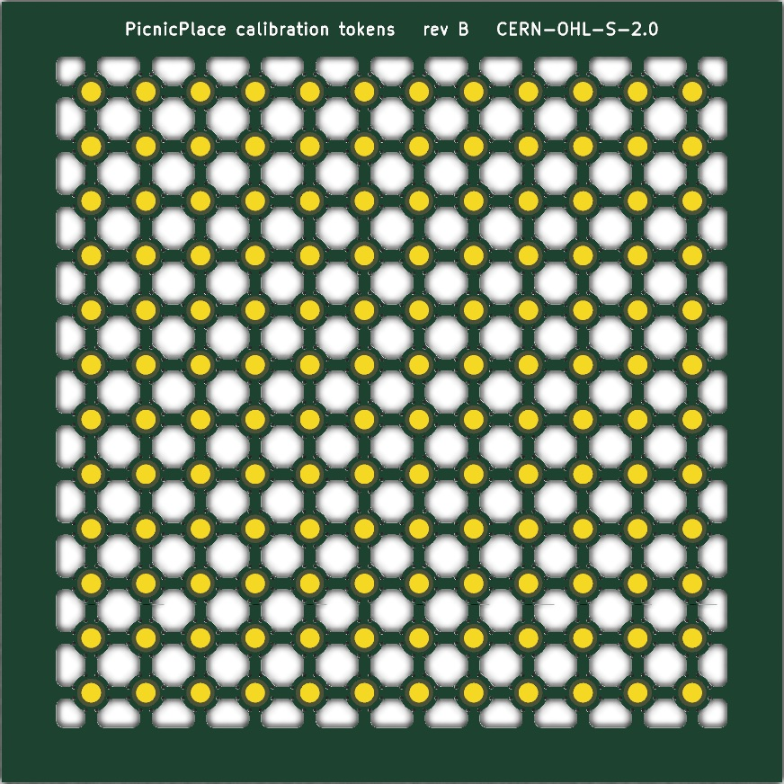

# Calibration token

A small round board that stop 2 of the setup wizard (nozzle offsets) picks up, turns and
puts down, so the top camera can see where each nozzle really is. It takes the place of
a paper hole punch, which is light enough to jump up to a tip before it touches, and can
curl, so its turns disagree.

The token and its panel are KiCad 10 files generated by a script,
`hardware/token/make_token.py`, which builds one token and then a panel of them with
KiKit. Every dimension is there; change it and run it again rather than editing either
board by hand. The design files are licensed under the CERN Open Hardware Licence,
strongly reciprocal (CERN-OHL-S-2.0); see `hardware/README.md`.

## The token

- **Size:** 5 mm across, 0.8 mm FR4, two layers. About 40 mg, against some 3 mg for a
  paper punch, so it does not jump to the tip, and rigid, so it lies flat.
- **Top:** copper 3.6 mm across under solder mask, with a 2.5 mm mask opening in the
  middle. The opening is made from the copper pad's own mask margin, so it is centered on
  the copper by construction.
  - **For the tips:** stop 2 uses the N045 and N08 tips, one on each nozzle. Their faces
    (1.0 and 1.5 mm across) sit inside the opening on flat bare copper. A tip whose rim
    landed on the opening's edge would sit across the step where the mask ends (some
    15–25 µm) and could leak, which is why the larger tips are not used for this stop.
  - **For the camera:** the bare copper is bright against the mask, and its edge is set
    by the mask, not by the router, so the tabs' stubs do not move it.
- **Back:** a 3 × 3 grid of dots at 1 mm pitch, each copper 0.7 mm across under the
  unbroken mask with a silkscreen dot 0.4 mm across printed on it. The copper raises each
  dot some 35 µm above the mask around it, and the ink a little more, so the token stands
  off the board and air gets under it; it lets go when it is lifted. (Revision A printed
  the dots on a plain copper disc, so they stood only the ink's height.)
- **Edge:** the copper stops 0.7 mm in from it, clear of the routed edge and the mouse
  bites.

## The panel

- **Size:** 100 × 100 mm, with 7 mm rails all round and the panel's name, revision and
  license printed on the top rail.
- **Tokens:** 12 × 12, 144 in all, 2 mm apart (the router's bit).
- **Tabs:** each token is held by four tabs 1.5 mm wide, to its neighbors or to the rail,
  with 0.5 mm mouse-bite holes at 0.75 mm pitch. The holes sit 0.15 mm into the token, so
  the stub a tab leaves when it breaks off stays inside the token's round edge and the
  token lies flat. Smooth what is left with a fine file or sandpaper if it catches.
- **No parts:** nothing is assembled, and there are no placement or BOM files.

## Ordering

Send the house the panel, `picnicplace-token-panel.kicad_pcb` (plotted to Gerbers and a
drill file), as one board:

- 2 layers, **0.8 mm** thick;
- **ENIG** finish, so the opening is flat to seal on and bright to see. HASL leaves a dome
  of solder on a pad that size;
- **white** solder mask, so the token stands out on the datum's dark mask the way a paper
  disc does. Its bare copper opening, dark in blue light where the white mask is bright,
  still marks its center;
- the panel is already made: tell the house it is one design, delivered as one board, so
  it does not panelize it again.

## In use

Lay a token on the datum board's bare area, opening up, and start stop 2 with the N045
on one nozzle and the N08 on the other. One token is enough; keep the rest for when it
is lost or worn.

Finding the token by its opening, and taking the N045 and N08 for this stop, are
planned. Until then, stop 2 looks for a round disc 4 to 12 mm across, as it does for a
paper punch.
