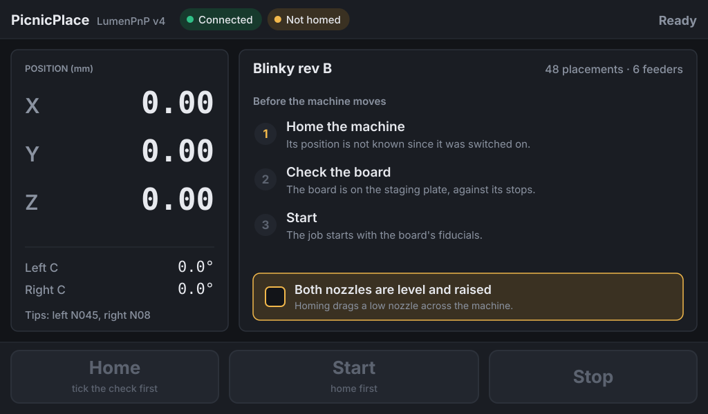
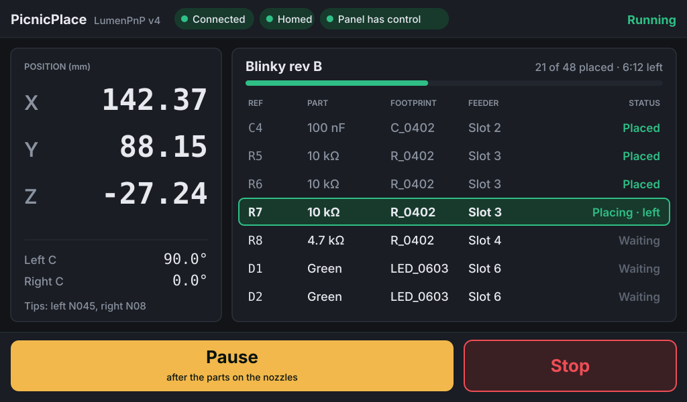
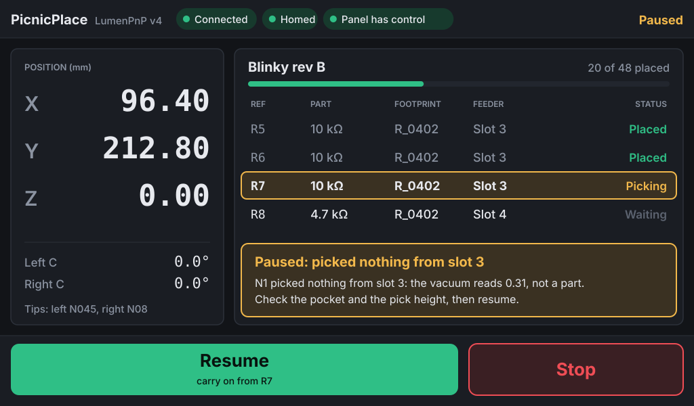
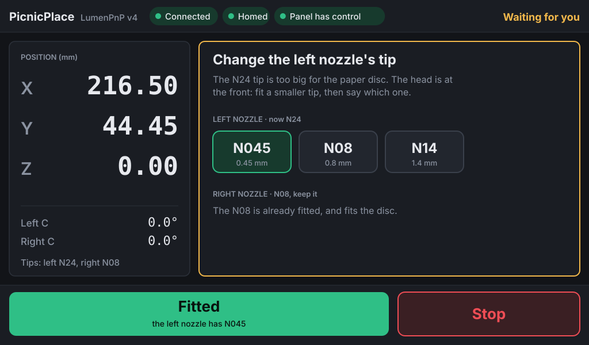

# Control panel (concept)

The control panel has two parts, and the operator can use either one or both:

- **A panel mounted on the machine.** It has a touchscreen for the machine's state and
  job controls, and an emergency stop.
- **A game controller for jogging.** Any controller that Linux supports, such as an
  Xbox controller, connects to the computer running the core. The controller gives
  physical controls without designing or selling a pendant.

With both, the operator watches the machine or the camera video while their hands stay
on physical controls. The Studio becomes mostly camera video.

PicnicPlace plans to publish the panel as open hardware, and it may also be sold
assembled. A first version of the panel runs on the reference display, with the core's
side of its link: see [What is built](#what-is-built). The enclosure, the E-stop wiring
and the game controller are still concepts.

## Why physical controls

Jogging on a touchscreen is no better than clicking jog buttons in the Studio with a
mouse. The operator still has to look at the controls, not the nozzle or the camera
image. Sticks and buttons can be used without looking, so they are worth the cost.

OpenPnP already supports a Linux joystick, so a game controller is a proven approach.
It is also a cheap and familiar one: one stick for X and Y, another for Z and C. The
panel then needs no jog hardware. It stays small enough to mount on the machine, and
its touchscreen keys are only for things done while looking at the panel anyway, such
as starting a job, answering a prompt or pausing.

## The panel

- **A touchscreen.** The reference design is the Waveshare ESP32-S3-Touch-LCD-7B, a 7"
  1024 × 600 display with capacitive touch and native USB (see
  [The reference display](#the-reference-display)). The ESP32 on the board runs the
  panel. Smaller boards can come later (see [Other displays](#other-displays)).
- **An emergency stop (recommended).** It is a latching mushroom switch with two poles:
  - one pole cuts the machine's power directly, without passing through the ESP32 or
    any software (see below);
  - the other is read by the ESP32, so the core knows why the machine stopped.
- **An enclosure** that mounts on the machine's frame, where the E-stop is in reach
  from wherever the operator stands. A game controller has no E-stop, so the panel's
  E-stop must always be easy to reach.

A lighter version without the touchscreen is just the E-stop in a box. It can be built
from the same enclosure design.

### How it connects

```
  E-stop pole 1 ── machine's 24 V ──► LumenPnP mainboard (controller and motors)
  E-stop pole 2 ──► ESP32 panel ── USB ──┐
                                         ├──► picnicd (core) ── USB ──► controller
  game controller ── USB or Bluetooth ───┘          │
                                                    └─ HTTP/WebSocket ──► Studio (video)
```

**Neither device talks to the machine's controller.** Both are inputs to the core, and
every move goes through the machine service. They get the same safety checks as the
Studio:

- the axis limits;
- no X/Y moves while a nozzle is below safe Z;
- the control lease, taken for the panel and controller while someone uses them, and
  shown in the Studio;
- Pause.

**The panel connects over USB, not Wi-Fi.**

- The panel could use the core's HTTP API over Wi-Fi, with no new code in the core.
- USB needs no network setup or pairing, and the core sees a disconnect at once.

The panel appears as a USB serial device and exchanges short JSON messages, one per
line, with the core. A `[panel]` section in the config names the port.

### What the screen shows

- **The state:** connected, homed, paused, the E-stop, and the lease holder.
- **Position:** X, Y, Z and C, and the controller's jog step.
- **The current step:**
  - a job: its task list, with the placement under way highlighted, and progress;
  - a wizard step: its instruction, such as "Put the paper disc in the bare area, then
    press OK".
- **Keys:** Home, Start, Pause/Resume, Stop, and answers to prompts.
- **Messages:** errors from the core, in the same words the Studio shows.

**The panel's job stays narrow.** Anything that needs judging a camera image stays in the
Studio, such as finding a fiducial, checking a pick, or drawing a keep-out. This keeps
the panel from becoming a second front end. The core already sends what the panel shows
through its machine state, job run state and wizard run events.

## The reference display

The panel is designed first for the
[Waveshare ESP32-S3-Touch-LCD-7B](https://www.waveshare.com/esp32-s3-lcd-7b.htm?sku=31726)
(SKU 31726, the touch version). Its large screen can be read from where the operator
stands, and its buttons can be pressed without looking twice. It costs about US$39.

| | |
|---|---|
| Module | ESP32-S3-WROOM-1-N16R8: dual-core 240 MHz, 16 MB flash, 8 MB PSRAM |
| Display | 7" IPS, 1024 × 600, RGB interface, 170° viewing angle |
| Touch | Capacitive, 5 points, on I2C, behind tempered glass |
| Glass | 192.96 × 110.76 mm; visible area 154.88 × 86.72 mm (0.15 mm per pixel) |
| Depth | About 17 mm, glass to the back of the connectors |
| Mounting | Four M3 mounts on the back, 126.2 × 65.65 mm apart |
| Power | 5 V on USB-C, about 350 mA |
| Connectors | Two USB-C (native USB, and a USB-to-UART bridge), RS485, CAN, I2C, UART, a GPIO header, a microSD slot, a Li-ion battery header |
| Wireless | 2.4 GHz Wi-Fi and Bluetooth LE (not used by the panel) |
| Operating temperature | 0 to 65 °C |

The figures come from Waveshare's product page, wiki, drawing and schematic. Check the
mounting dimensions against Waveshare's own drawing before cutting an enclosure.

**How the panel uses the board:**

- **The link to the core:** the native USB-C port, as a USB serial device. One cable
  carries both data and power. The native USB shares its pins with CAN, so the firmware
  selects USB through the board's I/O expander and leaves CAN unused. The port appears as
  Espressif's "USB JTAG/serial debug unit"; the firmware's log goes to the other port.
- **The E-stop's sensing pole:** the GPIO header (3.3 V, GND and GPIO6). The contact is
  normally closed and pulled up, so a pressed switch or a broken wire both read as
  pressed.
- **The backlight:** switched and dimmed by the I/O expander, a small microcontroller with
  Waveshare's firmware at I2C address 0x24 (its PWM is inverted: duty 0 is full
  brightness). The panel dims it after a few minutes
  idle, but never while a job runs, a prompt waits, or the machine moves. A touch on a
  dim screen only wakes it: that touch presses nothing.
- **Unused:** Wi-Fi, Bluetooth, the battery header, the microSD slot, and RS485. RS485
  could later carry the link over a long cable.

**The firmware** is in [`panel/`](https://github.com/mfarver/picnicplace/tree/main/panel)
in the repository: ESP-IDF 6 and LVGL 9 (MIT-licensed), built in Espressif's container
with `make panel`. A full 1024 × 600 frame at 16 bits is 1.2 MB, so the frame buffer lives
in the PSRAM. A first version runs on a real 7B: the status bar, the position, the core's
messages, and Home, Pause or Resume, and Stop, over native USB; the core's side of the
link is next.

## Screens

These mockups are drawn at the display's full size, 1024 × 600, in the Studio's dark
theme. They are generated by `docs/hardware/make_panel_svg.py`. The example job is
illustrative.

Every screen has the same three parts:

- **The status bar** (56 px, along the top): the machine's name; chips for connected,
  homed and who holds control; and the run state on the right (Ready, Running, Paused,
  or Waiting for you).
- **The position** (on the left): X, Y and Z large enough to read from a step back, each
  nozzle's angle, and the tips fitted. It updates about ten times a second while the
  machine moves.
- **The action bar** (104 px, along the bottom): two or three large buttons. The main
  action is on the left and wide. Stop is always on the right, in red.

### Ready

{ .pp-screenshot }

A job is loaded, but the machine is not homed. The panel lists what happens before the
machine moves.

**Homing asks for the same check as the Studio's Home.** The operator ticks "Both nozzles
are level and raised" each time, and only then does Home light up. The core still runs
its own checks, such as the safe-Z sensor, and its refusal shows here in its own words.
Start lights up once the machine is homed and the job can run.

### Running

{ .pp-screenshot }

**The task list** shows the job's placements in order:

- each row's reference, part, footprint, feeder slot, and status: Placed, Skipped,
  Waiting, or what is happening now;
- the placement under way highlighted, with its step (Picking, Aligning, Placing) and
  the nozzle doing it;
- placements already done above it in gray, those to come below it.

The list scrolls itself to keep the current placement in view. The operator can drag it
to look further, and it scrolls back after a few seconds. Above the list are the
progress bar, the count placed, and the time left.

**Pause** and **Stop** work as the Studio's do: the run places the parts already on the
nozzles, then pauses or stops. Neither stops a move halfway. Stop is not an emergency
stop: for that, press the E-stop switch, or unplug the controller or press its reset
button.

### Paused on a problem

{ .pp-screenshot }

When the run pauses on a problem, the placement it stopped at turns amber, and the
core's message appears below it. The message is word for word what the Studio shows.
Once the operator has dealt with the problem, Resume carries on from there.

### Waiting for the operator

{ .pp-screenshot }

A job or a calibration may need something done by hand, such as a tip change. The core
moves the head to the front center, then asks. The panel shows the core's question:

- the title and message;
- the choices for each nozzle;
- the main button, which sends the answer.

This is the same request the Studio shows. Whichever screen answers first wins, and the
other closes its copy.

### Sizes

The reference display has about 6.6 pixels per millimeter.

| Element | Size | On the glass |
|---|---|---|
| Action buttons | 76 px tall, 300 to 660 px wide | 11 × 45 to 100 mm |
| Smallest touch target (a tip choice) | 136 × 72 px | 21 × 11 mm |
| Position digits | 44 px type | digits about 5 mm tall |
| Body text | 15 to 18 px, never smaller than 13 px | 2 to 2.7 mm |

Touch targets are at least 64 px (10 mm) in each direction, so they work with gloves or
dirty fingers.

## What the panel and core say to each other

Both sides send JSON, one message per line. The panel keeps no state of its own: it
draws what the core last sent. The core sends `state` at least once a second, and the
panel shows "No connection to the core" when nothing has come for two seconds.

**From the core:**

- `state`: connected, homed, who holds control, the run state, the position, and the
  tips fitted;
- `job`: the job's name, progress, and a window of the task list: about ten rows around
  the current placement, so the panel never holds the whole job;
- `request`: a question for the operator, or that it was answered elsewhere;
- `message`: an error or notice, in the Studio's words;
- `backlight`: the backlight's brightness, 0 to 100.

**From the panel:**

- `hello`: its firmware version and screen size, when it starts, and every five seconds
  until the core answers;
- `ping`: every second. A panel silent for three seconds is no longer a client;
- `press`: a key: `home` (sent only after the check is ticked), `start`, `pause`,
  `resume` or `stop`;
- `answer`: the answer to a request, by its ID;
- `estop`: the sensing pole's state, whenever it changes.

**Keys need control.** A key works only while the panel holds the control lease. When the
Studio holds it, the status bar says so, and the action bar offers Take control instead,
under the same rules as the Studio. The core checks every press as it would a click in
the Studio. The panel cannot do anything the API cannot.

## What is built

- **The firmware** (`panel/` in the repository; see its README): the screen in portrait
  (600 × 1024), for mounting upright on the machine's side rail; the status bar, the
  position in seven-segment digits, the tips, the core's messages, Home after the
  nozzles-level check, Pause or Resume, and Stop, "No connection to the core", the
  backlight, and the E-stop input, over native USB. Tried on a real 7B.
- **The core's side** (`core/src/picnicplace/panel.py`): with `[panel] port` set in the
  config, the core opens the panel's port (again whenever it is plugged in), counts the
  panel as a connected client while it pings, sends `state` twice a second and on every
  change, and sends a failed operation's error as a `message`. Home and Resume take the
  control lease as the Studio's buttons do (a free lease; not one the Studio holds, which
  is refused in the core's words). Pause and Stop work from any client; during a job they
  pause or stop the run once the parts on the nozzles are placed. The E-stop's sensing
  pole is logged and kept, not yet shown.
- **Not yet:** `job`, `request` and `answer` (the task list and the operator's questions),
  Start, Take control, and dimming when idle.
- **The enclosure:** designed (below), not yet printed.

## The enclosure

`hardware/panel-enclosure/make_enclosure.py` generates it with CadQuery: STEP and STL
files for each part, in `out/` next to it. Every dimension is in the script; change it and
run it again rather than editing the models.

- **How it stands:** just left of a LumenPnP near its front, facing the operator, its
  bottom edge on the table, leaning back 45° so the screen faces up between a standing and
  a sitting operator's eyes. The top is 186 mm above the table, the screen's center 115 mm.
  A flat bracket bolts its right side to the machine's lower left 2020 rail, with two M5
  screws into T-nuts in the rail's outer slot.
- **The screen:** the 7B in portrait, its USB-C ports at the bottom. A 2 mm lip holds the
  glass from the front, its window 166.9 × 102.9 mm: 1 mm beyond the opening in the glass's
  black print, which is not centered on the glass, but never closer than 2 mm to the
  glass's edge. Behind the glass there is 31 mm for the connectors with their plugs in
  (about 22 mm) and their wires' bends.
- **Holding the board:** the board's own 8 mm standoffs go in the four M3 holes of its
  frame. Posts on the back cover meet their ends, and four M3 × 20 screws through the
  cover hold the board, pressing the glass against the lip. Four more M3 screws, into
  heat-set inserts in the shell's corners, close the cover.
- **The E-stop:** a TE ALCOSWITCH 2416049-1 (PBES22, 22 mm, illuminated), in a pod below
  the screen, its face flush with the screen's. The hole is 22.5 mm with the
  anti-rotation ring's notch, in a 3 mm face (the ring takes 1.2 to 4.5 mm); behind it
  are 45.7 mm of switch and room for the wires, which leave the contact blocks sideways.
  The switch sits 25 mm right of center so the USB cable drops past it.
- **Cables:** an opening between the shell and the pod carries the USB-C cable, plugged
  straight down into the board, and the sensing pole's wires to the board's header. Both
  cables, USB and the power pole's to the machine's 24 V, leave through the pod's back
  cover; the USB slot passes a USB-A plug.
- **Parts:** shell, back cover, pod, pod back and bracket, each within a 220 mm cube (a
  Flashforge Adventurer 5M Pro). The shell and pod screw together with two M3 screws into
  inserts; the bracket takes two more.
- **Test fit:** give the script the makers' STEP models (not kept in the repository) and
  it reports any part that overlaps them, writes the whole fit as glTF
  (`out/panel-fit.glb`), and writes the enclosure and switch in Waveshare's coordinates
  (`out/panel-in-board-coordinates.step`) to open over their model in CAD:

  ```sh
  python hardware/panel-enclosure/make_enclosure.py --board ESP32-S3-Touch-LCD-7B.stp \
      --estop c-2416049-1-a1-3d.stp
  ```

  Against Waveshare's model of 2025-10-25 and TE's, nothing overlaps but the switch's
  mounting ring, which TE's model draws 2.4 mm behind the face; the real ring threads
  back to the 3 mm face.
- **Still to measure:** the rail's height above the table (`RAIL_HEIGHT`), which places
  the bracket's M5 holes. Until then the bracket is drawn for 30 mm; do not print it.

## Other displays

The layout is drawn on a grid, not in fixed pixels, so it adapts to other screens:

- **800 × 480** (5" boards): the same layout, slightly smaller, with fewer task rows.
- **480 × 480** (the Waveshare 4" board): one card at a time: the task list, with the
  position in a strip above it. Prompts take the whole screen.
- **Below 480 px:** a status-only panel with the run state, the current placement, and
  Pause and Stop.

Capacitive touch and native USB remain the requirements. A board with resistive touch
or a USB-to-serial bridge only, such as the "Cheap Yellow Display", could work but is
not a target.

## The game controller

The core reads the controller directly, on the computer it runs on. A `[controller]`
section in the config turns it on and can change the mapping. A first mapping, for an
Xbox-style controller:

| Control | Action |
|---|---|
| Left bumper (held) | Enable: nothing moves unless it is held |
| Left stick | X and Y, proportional: the further, the faster |
| Right stick, up and down | Z, proportional |
| Right stick, left and right | C (rotation), proportional |
| D-pad | X and Y, one step per press |
| Right bumper | Next jog step: 0.01, 0.1, 1 or 10 mm |
| A / B | OK / Cancel on a prompt |
| Start | Pause / Resume |

**The enable button matters.** A controller dropped on its stick, or one with a
drifting stick, must not move the machine.

**Reading the controller:**
- On Linux, the kernel's event devices (`evdev`) give the sticks and buttons and report
  when a controller is unplugged or a Bluetooth link drops.
- SDL's game controller support works on Linux, macOS and Windows. It also has a mapping
  database, so most controllers work without setup. It is a heavier dependency.

## Jogging that stops when you let go

Marlin finishes the moves it has already been sent before it acts on anything new. This
is the lesson of `M112`, which the Studio no longer sends. A jog therefore must never
send one long move. Instead, while the stick is held:

1. The core reads the stick about 20 times a second.
2. It turns each reading into a short move, about 0.1 s long at the requested speed.
   It keeps no more than two moves queued.
3. The core stops jogging when any of these happens:
   - the stick returns to center or the enable button is released;
   - the controller disconnects;
   - the machine pauses or the E-stop is pressed.

   The head then coasts for at most what is queued, a few millimeters at full speed.

The jog loop lives in the core's machine service, not in any device, so the simulator
can test it. A simulated controller in the Studio sends the same inputs. The core side
is then built and tested before any hardware exists.

## The E-stop on a LumenPnP

The LumenPnP v4 mainboard takes a single 24 V supply for both the controller and the
stepper drivers. Without changing the board, the E-stop has to cut all 24 V.

That is acceptable:

- The motors stop at once. So do the pump and the valves, so a part on a nozzle drops.
- The controller resets. The core sees the disconnect, and the sensing pole tells it
  why.

The core then:

- marks the machine as no longer homed;
- stops any job or wizard step, as Stop does;
- shows "E-stop pressed: release it, then connect and home" on the panel and in the
  Studio.

The core never moves the machine by itself after an E-stop. The switch goes between
the power supply and the mainboard. It must be rated for the supply's full current.

## Software work in PicnicPlace

- **The core:**
  - a `panel` driver for the serial link;
  - a `controller` driver for game controllers;
  - the release-to-stop jog loop in the machine service;
  - E-stop state in `MachineState`;
  - wizard prompts that the panel's OK, or the controller's A, can answer.
- **The Studio:**
  - shows when the panel or controller holds the lease;
  - a simulated controller for testing.
- **The panel's firmware:** for the ESP32, in this repository, under MPL-2.0.

## Licensing and sale

- **Hardware:** CERN-OHL-W, which matches the spirit of MPL-2.0. It covers the
  enclosure's CAD files, the wiring, and any adapter PCB.
- **Firmware:** MPL-2.0.
- **Selling it assembled:**
  - Use a pre-certified ESP32 module. The display boards above already use one.
  - Describe the E-stop as a power cutoff, specify a switch rated for the current, and
    document the wiring.
  - Game controllers are bought separately. PicnicPlace documents which ones are
    tested.

## Open questions

- Reading the controller with `evdev` (Linux only, light) or SDL (cross-platform,
  heavier)? The core usually runs on Linux next to the machine.
- Whether the panel itself should also offer coarse jogging, for operators with no
  controller.
- Other machines: the E-stop wiring is documented per machine. Boards with separate
  motor power can keep the controller running.
- Whether a run paused on a problem should offer Skip on the panel, for a placement the
  operator decides to leave off, or keep that in the Studio.
- Whether the panel needs a light theme, for brightly lit benches.
- Whether 45° suits operators, once the enclosure is printed and used.
