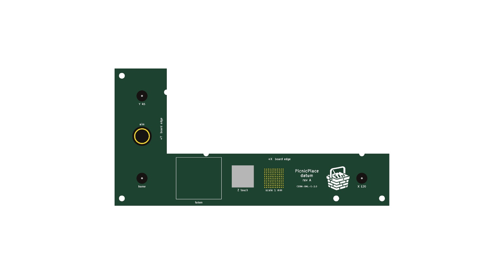

# PicnicPlace datum

PicnicPlace requires a datum board, even on machines that are not LumenPnPs. This is
the design PicnicPlace publishes for one. The PCB is drawn (revision A, not yet made);
the 3D-printed holder is still a concept.

The PCB is a KiCad 10 file generated by a script, `hardware/datum/make_datum.py`, which
holds every dimension: change the numbers there and run it again with KiCad's Python,
rather than editing the board by hand. The plan view above is drawn by
`make_datum_svg.py`, next to this page; keep the two in step, then run
`python3 docs/hardware/make_datum_svg.py > docs/hardware/picnicplace-datum-plan.svg` from
the repository root. The design files are licensed under CERN-OHL-S-2.0 (see
`hardware/README.md`).

## The idea

The datum is an L-shaped PCB, 150 × 75 mm with 30 mm legs, held in a fixed place on the
staging plates. Its inside corner is a common origin for rectangular boards: push a board
or panel into the corner and the job knows roughly where it is before any fiducial is
found. The board's own fiducials correct what remains, so the corner has to be close and
repeatable, not exact. The L does not have to run the length of the board's edges: the
LumenPnP board holders, or later vacuum standoffs, support the other sides.

- **Locating pins, not the routed edge.** A board touches three 3 mm dowel pins, two
  along X (at 20 and 105 mm) and one along Y (at 32 mm). Fabs typically rout an outline
  to only ±0.1–0.2 mm, but holes are drilled much more accurately. A pin that touches
  the board's edge has its center 1.5 mm from it, so the PCB, level with the board,
  cannot surround it. Instead the PCB's inside edges run through the pin centers, 1.5 mm
  back from the board, and each pin sits in a 3.0 mm unplated half-hole that is drilled
  before the edge is routed: the drill, not the router, sets where the pin is. The
  holder below grips each pin's foot. Only the pins touch the board.
- **Calibration features**, as on the LumenPnP datum, and more:
  - a homing dot in the corner square, at (−15, −15) from the board's corner: a 1 mm
    copper dot in a 6 mm mask opening;
  - an aiming ring, 8 mm across;
  - a bare area, 24 × 22 mm, for the nozzle-offset disc or
    [token](calibration-token.md), with nothing printed in it: a silkscreen box 0.3 mm
    outside it, labeled "token", shows where to lay it;
  - a 12 × 12 mm copper pad the nozzles touch to find their height;
  - a scale target: 11 × 11 dots, 0.5 mm across, at 1 mm pitch;
  - fiducials 120 mm along X and 45 mm along Y from the homing dot, like it. Measured
    with the top camera, these give each axis's scale and show whether the gantry is
    square, which one dot cannot.

  - the label (name, revision, license) and the PicnicPlace logo, in silkscreen. The
    logo is traced from `hardware/logo/picnicplace-icon-bw.png` by
    `hardware/logo/make_logo_outline.py`.

  Order it with ENIG, so the touch pad is flat and the dots bright, and with black (or
  green) solder mask: the camera looks for bright copper and paper on dark mask, and a
  white token stands out on it. Nothing on it is
  assembled: every feature is left out of the BOM and the placement files.
- **A 3D-printed holder** under the PCB:
  - It extends 4 mm beyond the PCB, with a 10 mm ledge under the board's edges.
  - Its top is level with the LumenPnP board holders: 8.4 mm above the staging plate,
    from published figures, to be checked with calipers. The board and the datum PCB
    both rest on it, so a 1.6 mm board's top and the datum's top are both 10.0 mm
    above the plate, and the height the nozzles measure on the datum carries over.
  - The PCB screws to it with four M3 screws into heat-set inserts. Their heads stand
    about 2 mm above the datum's top; the nozzles cross them only at safe Z.
  - It screws to the staging plate with M3 screws, 30 mm apart, counterbored in the
    ledge, reached with no board in place. The 30 mm spacing fits v4.1's 15 mm
    checkerboard and v4.2's 30 mm grid.

The [test board](test-board.md) is its partner: the datum calibrates the machine, and the
test board shows whether the calibration worked.

## Open questions

- The 3D-printed holder: not yet modeled.
- The pins' fit: the half-holes are drawn at exactly 3.0 mm, for 3 mm h6 dowels.
- The LumenPnP board holders' height, which sets the holder's height: 8.4 mm from
  published figures, to be confirmed with calipers.
- The exact hole layout of v4.2's metal staging plates.
- Where the datum goes on the plates. The two plates are about 240 mm deep. A Letter
  board (216 mm) plus the 30 mm leg needs about 250 mm, and the bottom camera and the
  LumenPnP datum take part of the front plate, so the largest board is a little smaller
  than a sheet of paper.
- Vacuum hold-down, planned for later: hollow printed standoffs with soft seals,
  connected to a reversed aquarium pump and switched from a spare output.
