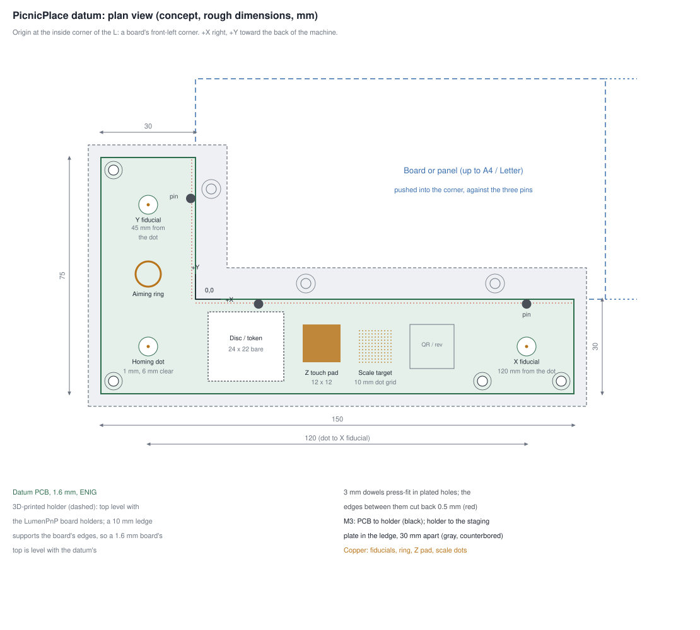

# PicnicPlace datum (concept)

PicnicPlace requires a datum board, even on machines that are not LumenPnPs. This is
the design PicnicPlace plans to publish for one. It is a concept, and every dimension is
still rough.

The drawing is generated by `make_datum_svg.py`, which sits next to it. Change the
numbers there, then run `python3 docs/hardware/make_datum_svg.py >
docs/hardware/picnicplace-datum-plan.svg` from the repository root.

## The idea

The datum is an L-shaped PCB, 150 × 75 mm with 30 mm legs, held in a fixed place on the
staging plates. Its inside corner is a common origin for rectangular boards: push a board
or panel into the corner and the job knows roughly where it is before any fiducial is
found. The board's own fiducials correct what remains, so the corner has to be close and
repeatable, not exact. The L does not have to run the length of the board's edges: the
LumenPnP board holders, or later vacuum standoffs, support the other sides.

- **Locating pins, not the routed edge.** A board touches three 3 mm dowel pins, two
  along X and one along Y, press-fit in plated holes. Fabs typically rout an outline to
  only ±0.1–0.2 mm, but drill and copper are placed much more accurately. The PCB's
  inside edges are cut back 0.5 mm between the pins, so only the pins touch the board.
- **Calibration features**, as on the LumenPnP datum, and more:
  - a homing dot in the corner square;
  - an aiming ring;
  - a bare area for the nozzle-offset disc or token;
  - a copper pad the nozzles touch to find their height;
  - a 10 mm dot-grid scale target;
  - fiducials 120 mm along X and 45 mm along Y from the homing dot. Measured with the top
    camera, these give each axis's scale and show whether the gantry is square, which
    one dot cannot.
- **A 3D-printed holder** under the PCB:
  - It extends 4 mm beyond the PCB, with a 10 mm ledge under the board's edges.
  - Its top is level with the LumenPnP board holders: 8.4 mm above the staging plate,
    from published figures, to be checked with calipers. The board and the datum PCB
    both rest on it, so a 1.6 mm board's top and the datum's top are both 10.0 mm
    above the plate, and the height the nozzles measure on the datum carries over.
  - The PCB screws to it with M3 screws into heat-set inserts.
  - It screws to the staging plate with M3 screws, 30 mm apart, counterbored in the
    ledge, reached with no board in place. The 30 mm spacing fits v4.1's 15 mm
    checkerboard and v4.2's 30 mm grid.

## Open questions

- The LumenPnP board holders' height, which sets the holder's height: 8.4 mm from
  published figures, to be confirmed with calipers.
- The exact hole layout of v4.2's metal staging plates.
- Where the datum goes on the plates. The two plates are about 240 mm deep. A Letter
  board (216 mm) plus the 30 mm leg needs about 250 mm, and the bottom camera and the
  LumenPnP datum take part of the front plate, so the largest board is a little smaller
  than a sheet of paper.
- Vacuum hold-down, planned for later: hollow printed standoffs with soft seals,
  connected to a reversed aquarium pump and switched from a spare output.
