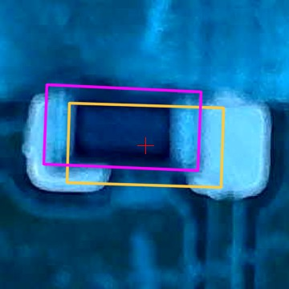

# PicnicPlace test board

A board for measuring how accurately a machine places. Nothing on it is soldered:
parts are placed onto clear double-sided tape laid over it, measured, and picked up
again, so one board serves for test after test. It is the partner of the
[datum](picnicplace-datum.md): the datum calibrates the machine, and the test board shows
whether the calibration worked.

The board is a KiCad 10 file generated by a script, `hardware/test-board/make_test_board.py`.
Every target is listed there; change the list and run it again rather than editing the
board by hand. The design files are licensed under the CERN Open Hardware Licence,
strongly reciprocal (CERN-OHL-S-2.0); see `hardware/README.md`.

## Why a test board

- **Evidence for accuracy.** "It places to within 0.1 mm" should come with numbers. After
  a run, the top camera looks at each part and measures how far it landed from where the
  board wanted it.
- **What calibration cannot see.** Calibration measures each piece on its own, at one
  place, with no part on the nozzle: the camera's scale, the nozzle offsets, the bottom
  camera, the heights. A placement test measures the whole chain, and catches what falls
  between the pieces:
    - an offset that changes with the part's turn (runout, or the wrong center of
      rotation), which is why every target comes at every quarter turn, and some at 45°;
    - bottom vision that is off for some footprints but not others, such as QFNs;
    - a part that slides as the vacuum is released or blown off;
    - a difference between the nozzles;
    - an error that grows across the board (calibration only measures at the datum).
- **One reference for everyone.** When every machine runs the same board, bug reports,
  flight recordings and accuracy figures can be compared, between machines and between
  versions of PicnicPlace.

## The board

- **Size:** 120 × 72 mm, two layers, 1.6 mm thick. It is wide enough to reach the
  datum's far X pin, at 105 mm, so it rests on X pins 95 mm apart. (Revision A was 92 mm
  wide, and on a revision B datum it reached only one X pin and could turn in the
  corner.)
- **Fiducials:** three 1 mm copper dots with 3 mm mask openings, at (4, 4), (116, 4) and
  (4, 68). Placed asymmetrically, so a board loaded turned round shows a dot where none
  should be and is caught instead of placed wrong.
- **Targets**, 60 in all:
    - 0402, 0603, 0805 and 1206 chips, 0805 LEDs, SOD-123 diodes, SOT-23 and SOT-23-6,
      each at 0°, 90°, 180° and −90°, and the 0402, 0603, 0805 and SOT-23 at 45° too;
    - SOIC-8 at 0°, 90°, 180° and 45°;
    - a 3 × 3 mm QFN-16 at every quarter turn and 45°, and a 5 × 5 mm QFN-32;
    - a **circle of twelve 0603s**, R15–R26, one every 30°, each turned to point along
      its radius. All are the same part, from the same feeder, at the same distance from
      the circle's center, so the only thing that changes round the circle is the turn.
      An offset that depends on the turn (nozzle runout, the wrong center of rotation, a
      part kicked as it is released) traces a sine wave round it. Run it once with each
      nozzle to compare them.
- **Each target** is the footprint's pads, with no paste, inside a **bare copper ring**
  0.3 mm outside the part's body and pads. The ring is the reference the measurement is
  made against: it stays visible around any part (a placed chip hides most of its pads,
  and a QFN all of them), and it is board copper, so it is the truth about where the part
  belongs. Silkscreen would not do: it can be printed 0.1–0.2 mm off the copper.
- **Silkscreen** outside each ring: an outline, and pin 1 marked as a dot at the corner
  nearest it, or a bar at the cathode end of an LED or diode.
- **References** printed above each target (outside it, round the circle), the same ones
  the position file and the run report use, so a part the report says is off can be
  found at a glance. Each is at least 0.4 mm beyond the outline, out of the area the top
  camera checks a placement in, so it is not taken for part of the part.
- **The PicnicPlace logo**, in silkscreen above the circle.
- **Generic parts.** Each footprint's part number is generic, such as `TEST-R0402`: any
  part of that kind and size will do, so parts left over from other jobs can be used.

Order it with green or black solder mask: the camera looks for bright copper and parts'
end caps against dark mask, so avoid white or yellow. ENIG is preferred, since its rings,
pads and fiducials are flat and evenly bright. HASL works too: nothing is soldered, and
under the tape its slightly domed pads make no difference, though it can glare under the
top camera's light.

## A test, step by step

Steps 1, 2 and 5 work today, and step 3 in part; the rest is planned.

1. Lay strips of clear double-sided tape over the targets, and load the board into the
   datum's corner. The tape must be clear, so the camera sees the rings through it, and
   it adds its thickness (about 0.1 mm) to the board's.
2. Run the test board's job like any other, with its parts on feeders, strips or trays,
   and **Check each part with the top camera once placed** ticked.
3. **Inspect placements.** Today, the top camera looks at each two-terminal chip as soon
   as it is placed, finds the part and its pads in the same picture, and measures how
   much of each of the part's ends lies on its pad; one with less than 75% of an end on
   its pad, or turned more than 10°, is held for a review once every part is placed. Since the part is measured from its
   own pads, the gantry's position and the board's fit hardly enter the measurement. If
   the pads are more than 0.4 mm from where the board's fit puts them, the board has
   moved: the run pauses, and finds the fiducials again on resume. Planned: measuring
   each part from the copper ring around it as well, so ICs and QFNs, whose pads the
   part hides, are measured too.
4. **The report**, planned: each part's offset and turn, the spread for each nozzle, and
   how the error depends on the part's angle (the circle of 0603s) and its place on the
   board, kept with the run and sent with a flight recording. Today the finish message
   and the Run workspace give the run's statistics: picks, empty picks, parts the bottom
   camera could not find, placements, and checked placements off their pads.
5. Pick the parts up again (or peel off the tape), and the board is ready for the next
   test.

{ .pp-screenshot width="300" }

A real check, on a LumenPnP: an 0603 resistor on double-sided tape, where it was sent
(orange) and where the top camera found it (magenta), 0.35 mm off. The run paused on it,
and its picture was on its line in the step list.

The simulator will offer the same board, with its parts in the library and on simulated
feeders, so a test can be tried with no machine.

## Open questions

- **A panel.** A KiKit panel of two would also exercise panels.
