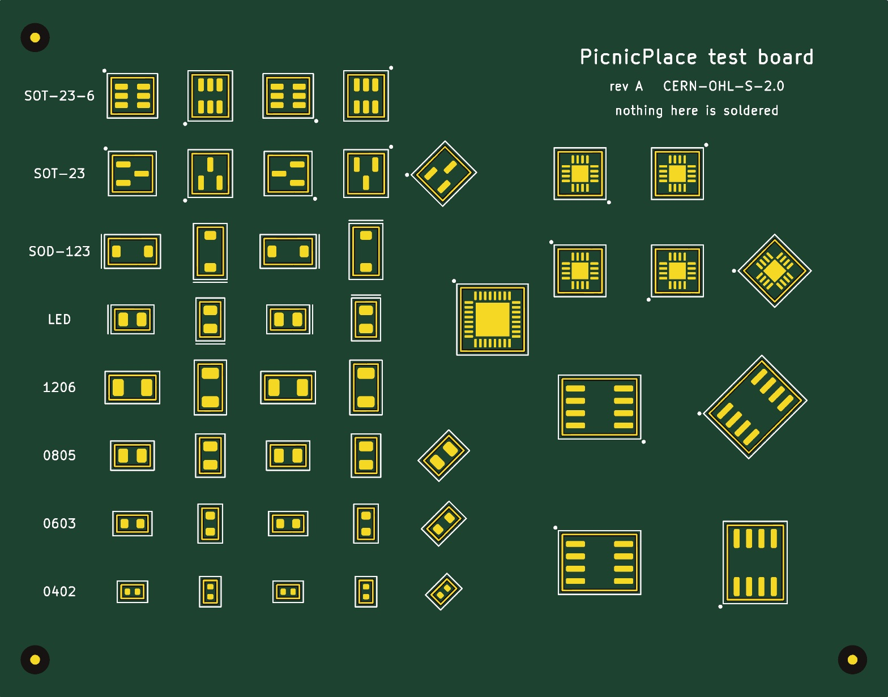

# PicnicPlace test board

A board for measuring how accurately a machine places. Nothing on it is soldered:
parts are placed onto clear double-sided tape laid over it, measured, and picked up
again, so one board serves for test after test. It is the partner of the
[datum](picnicplace-datum.md): the datum calibrates the machine, and the test board shows
whether the calibration worked.

The board is a KiCad 10 file generated by a script, `hardware/test-board/make_test_board.py`.
Every target is listed there; change the list and run it again rather than editing the
board by hand. The design files are licensed under the CERN Open Hardware Licence,
strongly reciprocal (CERN-OHL-S-2.0); see `hardware/README.md`.

## Why a test board

- **Evidence for accuracy.** "It places to within 0.1 mm" should come with numbers. After
  a run, the top camera looks at each part and measures how far it landed from where the
  board wanted it.
- **What calibration cannot see.** Calibration measures each piece on its own, at one
  place, with no part on the nozzle: the camera's scale, the nozzle offsets, the bottom
  camera, the heights. A placement test measures the whole chain, and catches what falls
  between the pieces:
    - an offset that changes with the part's turn (runout, or the wrong center of
      rotation), which is why every target comes at every quarter turn, and some at 45°;
    - bottom vision that is off for some footprints but not others, such as QFNs;
    - a part that slides as the vacuum is released or blown off;
    - a difference between the nozzles;
    - an error that grows across the board (calibration only measures at the datum).
- **One reference for everyone.** When every machine runs the same board, bug reports,
  flight recordings and accuracy figures can be compared, between machines and between
  versions of PicnicPlace.

## The board

- **Size:** 92 × 72 mm, two layers, 1.6 mm thick, so it sits in the datum's corner.
- **Fiducials:** three 1 mm copper dots with 3 mm mask openings, at (4, 4), (88, 4) and
  (4, 68). Placed asymmetrically, so a board loaded turned round shows a dot where none
  should be and is caught instead of placed wrong.
- **Targets**, 48 in all:
    - 0402, 0603, 0805 and 1206 chips, 0805 LEDs, SOD-123 diodes, SOT-23 and SOT-23-6,
      each at 0°, 90°, 180° and −90°, and the 0402, 0603, 0805 and SOT-23 at 45° too;
    - SOIC-8 at 0°, 90°, 180° and 45°;
    - a 3 × 3 mm QFN-16 at every quarter turn and 45°, and a 5 × 5 mm QFN-32.
- **Each target** is the footprint's pads, with no paste, inside a **bare copper ring**
  0.3 mm outside the part's body and pads. The ring is the reference the measurement is
  made against: it stays visible around any part (a placed chip hides most of its pads,
  and a QFN all of them), and it is board copper, so it is the truth about where the part
  belongs. Silkscreen would not do: it can be printed 0.1–0.2 mm off the copper.
- **Silkscreen** outside each ring: an outline, and pin 1 marked as a dot at the corner
  nearest it, or a bar at the cathode end of an LED or diode.
- **Generic parts.** Each footprint's part number is generic, such as `TEST-R0402`: any
  part of that kind and size will do, so parts left over from other jobs can be used.

Order it with ENIG, so the rings and pads are flat and bright.

## A test, step by step

All planned:

1. Lay strips of clear double-sided tape over the targets, and load the board into the
   datum's corner. The tape must be clear, so the camera sees the rings through it, and
   it adds its thickness (about 0.1 mm) to the board's.
2. Run the test board's job like any other, with its parts on feeders, strips or trays.
3. **Inspect placements:** the top camera visits each target. In one frame it finds the
   part's body and the ring around it, and measures the part's offset and turn from the
   ring. Part and ring are a few millimeters apart in the same image, so neither the
   gantry's position nor the camera's scale enters the measurement.
4. The report gives each part's offset and turn, the spread for each nozzle, and how the
   error depends on the part's angle and its place on the board. It is kept with the run
   and sent with a flight recording.
5. Pick the parts up again (or peel off the tape), and the board is ready for the next
   test.

The simulator will offer the same board, with its parts in the library and on simulated
feeders, so a test can be tried with no machine.

## Open questions

- **A panel.** A KiKit panel of two would also exercise panels.
