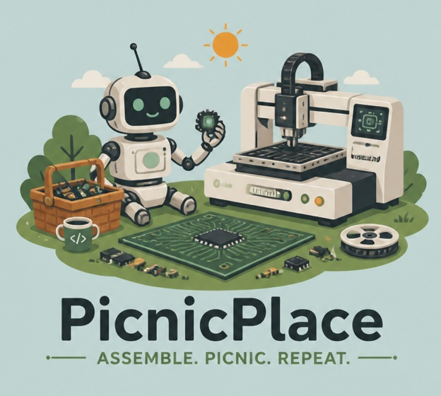
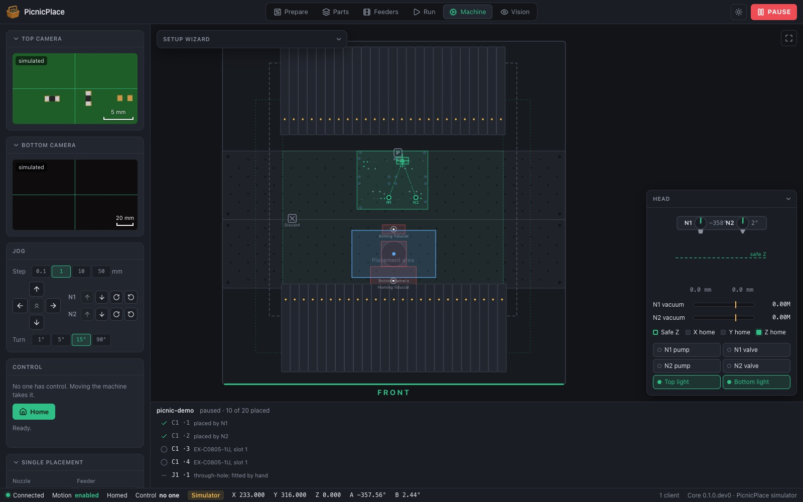
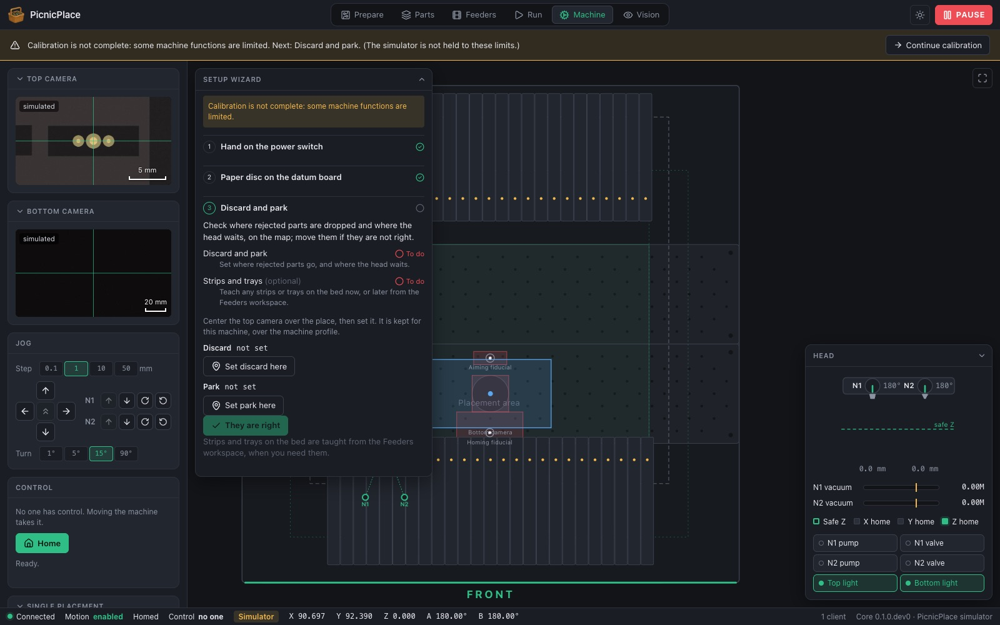
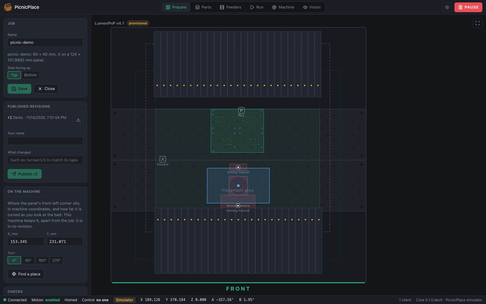
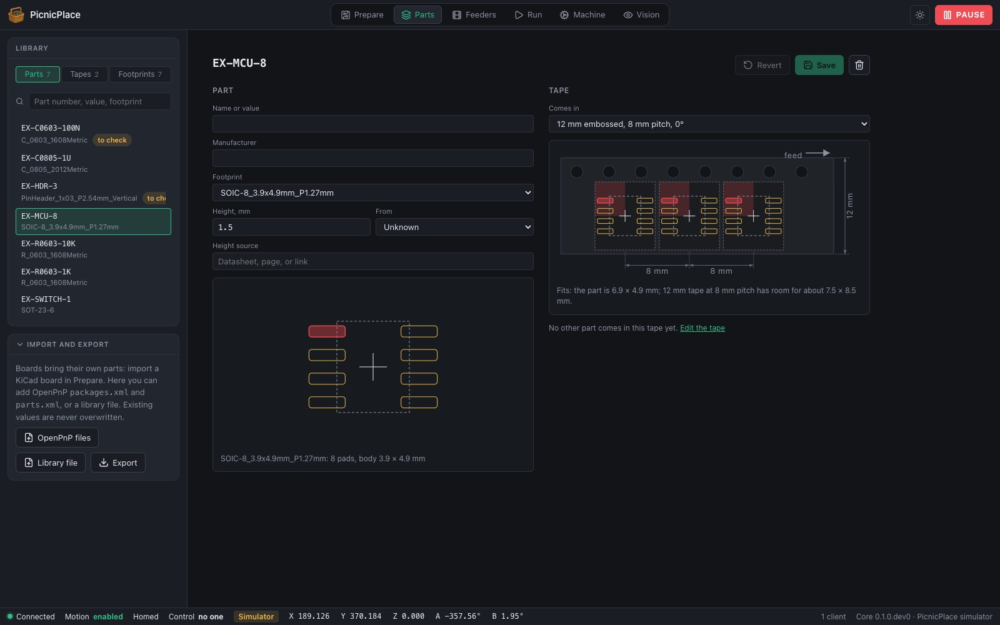
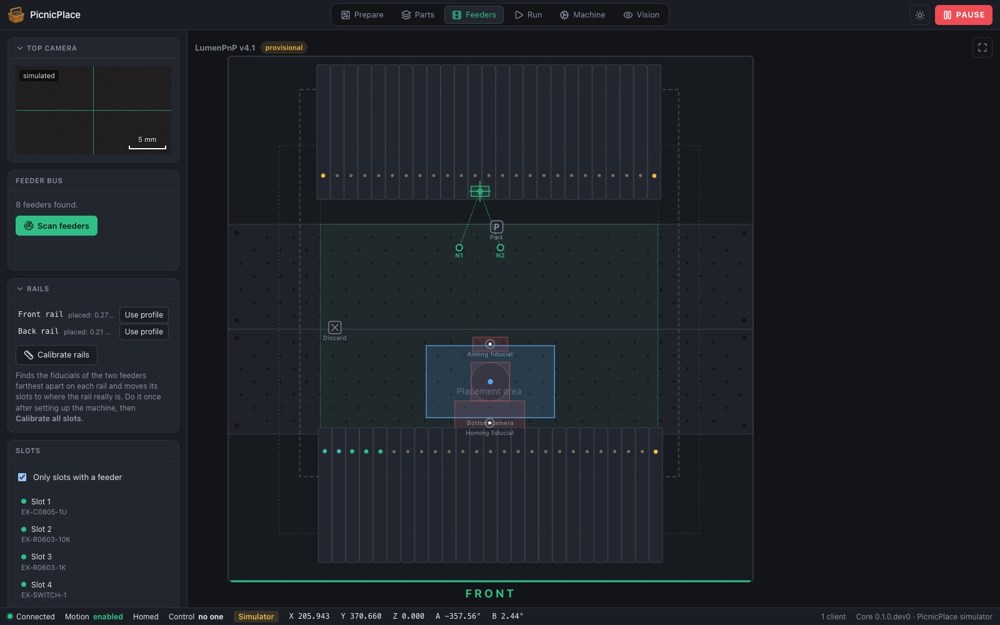
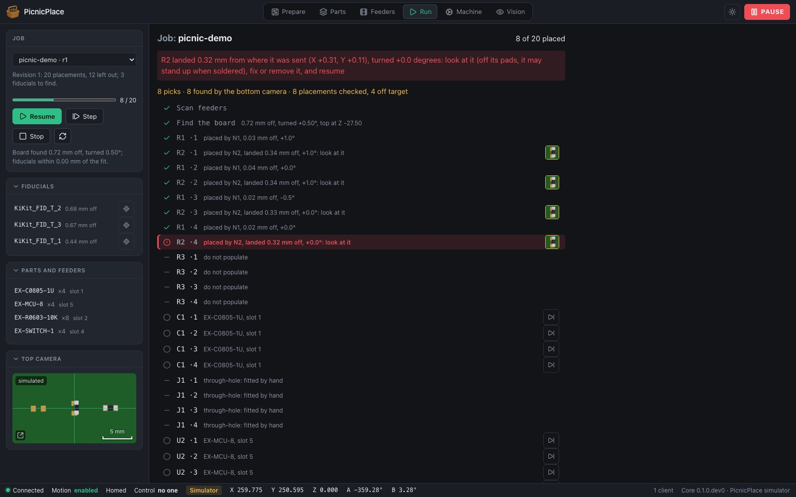

{ .pp-logo }

# PicnicPlace

An open source controller for PCB pick-and-place machines, built **network first**: a
headless core runs the machine, and every interface connects to it over a documented API.

[Try the simulator](guide/try-the-simulator.md){ .md-button .md-button--primary }
[Read the specification](SPEC.md){ .md-button }

!!! warning "Early development"

    PicnicPlace can't assemble a board on a real machine yet, and there is nothing to
    download: run it from source. In the simulator it places whole panels. On a real
    LumenPnP v4.1, homing, visual homing, jogging, the cameras, the vacuum sensors, and
    calibrating a feeder rail work; measuring the nozzles is under way. Follow along on
    [GitHub](https://github.com/mfarver/picnicplace).

## A look at the Studio

These are real screens from the Studio, connected to the built-in simulator and running
the demo board from PicnicPlace's tests: a KiKit panel of four.

=== "Machine"

    { .pp-screenshot }
    /// caption
    The Machine workspace, with a run paused partway: the map of the bed (feeder rails,
    staging plates, the panel, and where each nozzle is), the top and bottom cameras, jog
    controls, the head's vacuum, pumps, valves and lights, and the run's next steps.
    ///

=== "Setup wizard"

    { .pp-screenshot }
    /// caption
    The setup wizard calibrates the machine in three stops, each started with one
    button: homing, the cameras and the feeders; then, with a paper disc on the datum
    board, each nozzle's offset, height and vacuum levels; then the discard and park
    locations. Until it is done, the machine is limited and a banner says so.
    ///

=== "Prepare"

    { .pp-screenshot }
    /// caption
    Prepare: a KiCad board and its KiKit panel, imported and placed on the bed where
    every nozzle can reach every part, then published as a revision that runs exactly as
    it was checked.
    ///

=== "Parts"

    { .pp-screenshot }
    /// caption
    The parts library: a part's footprint with pin 1 marked, and a preview of it in its
    tape, with a check that it fits.
    ///

=== "Feeders"

    { .pp-screenshot }
    /// caption
    Feeders: Photon feeders found on the bus, each with its part, and the rails
    calibrated from the fiducials of the feeders farthest apart.
    ///

=== "Run"

    { .pp-screenshot }
    /// caption
    A run in the simulator, with one nozzle made to drop its parts 0.3 mm off: each part
    is checked with the top camera once placed, the run pauses on one off its target, and
    its picture is on its line. Above, the run's statistics; below, the parts left out and
    why.
    ///

## Why PicnicPlace

-   **Network first**

    ---

    The core (`picnicd`) runs on the machine's computer. The Studio GUI, scripts, and
    your own tools connect over a versioned REST and WebSocket API. Closing a browser
    never stops a job.

-   **Safety in the core**

    ---

    Moves travel at safe Z, a physical safe-Z sensor is authoritative when the machine
    has one, only one client controls the machine at a time, and any client can pause
    it.

-   **Vision built in**

    ---

    OpenCV-based visual homing on the machine's datum, camera and nozzle calibration,
    board fiducials, pockets found by their tape's sprocket holes, and parts aligned on
    the bottom camera.

-   **Develop without a machine**

    ---

    A built-in simulator renders camera images from the machine's real geometry, and a
    fake Marlin firmware exercises the real driver, so most work needs no hardware.

-   **Machine profiles**

    ---

    One TOML file describes a machine: axes, nozzles, cameras, staging plates, keep-outs,
    and I/O. Where boards can go is computed from where every nozzle can reach.

-   **Open, and staying open**

    ---

    Licensed under the MPL-2.0: improvements to PicnicPlace stay open, while separate
    add-ons and API clients may use any license.

## Machines

The first machine is the **LumenPnP v4.1**, with a machine profile built from the
machine's published design files and real OpenPnP configurations. The **v4.2** has
its own profile, built on the v4.1's (its camera, datum, and discard tray are near the
left end of the front plate); it has not been run on a real v4.2 yet. A
[Quad 4c](SPEC.md#10-lumenpnp-target)
conversion is planned next, and the driver and profile design avoid LumenPnP-only
assumptions. See the [LumenPnP notes](hardware/lumenpnp-v4.md).

## Roadmap

| Milestone | Scope | Status |
|---|---|---|
| M0: Skeleton | Core, simulator, event socket, Studio shell | Done |
| M1: Manual control | Machine profiles, machine view, jogging, safe-Z interlock, control lease, Marlin driver, camera streams | Done, and working on a real LumenPnP v4.1 |
| M2: Calibration | Visual homing (also on a real LumenPnP), camera scale, the bottom camera, nozzle offsets, heights by touch, vacuum levels, nozzle runout, a tip seat check on a paper pad after each tip change, discard and park locations, and the setup wizard (done in the simulator); lens calibration | In progress |
| M3: Single placement | Parts library (with shared tapes, pin 1, and a tape preview), Photon feeders (discovery, part assignment, feeding, slots calibrated from feeder fiducials, pockets found from sprocket holes, and in paper tape whether a pocket holds a part and parts lying loose, tested on real frames), pick, bottom-camera alignment (the part's outline, then its footprint's pads, both ways round for a SOT-23; tested on real frames), ring lights set to a color, training how the bottom camera sees a part (approved by the operator from its footprint drawn over it), and place: done in the simulator, to be tried on a real machine | In progress |
| M4: Jobs | KiCad board and KiKit panel import, placing a job within every nozzle's reach, board fiducials, planner and dry run, running a whole job with pause, step, and skip, strips and trays on the bed, feeders rescanned and each one's fiducial found on its first pick in a run, picks kept centered by the top or the bottom camera or both (auto), and a flight recorder (done in the simulator); run history | In progress |
| M5: 1.0 | Packaging and user documentation; the operator app at the machine and the Creator, a website for preparing jobs (job revisions, accounts, house parts, problem reports), a calibration checklist, and parts counted on every reel and tray | Started: job revisions and job files, which runs run; the calibration checklist; the top and bottom cameras and the nozzle offsets calibrated; board and part heights found by touch; each nozzle's vacuum levels measured; heights and vacuum levels kept for each nozzle tip, and the fitted tip's size seen by the bottom camera; tip changes asked for in a dialog, with the head at the front; the setup wizard, choosing the machine, its serial port and cameras and calibrating it, with the machine limited until it is done; homing asks that the nozzles be level; the PicnicPlace datum and test board drawn in KiCad, and the datum's printed holder modeled (not yet made) |

## Get involved

PicnicPlace is written in Python (the core) and TypeScript with React (the Studio), on
Linux first, with macOS supported for development. Start with
[Contributing](contributing.md), and open an issue or a discussion on
[GitHub](https://github.com/mfarver/picnicplace).

<small>LumenPnP and Opulo are trademarks of Opulo. PicnicPlace is an independent project
and is not affiliated with or endorsed by Opulo.</small>
