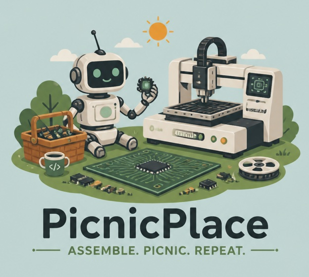
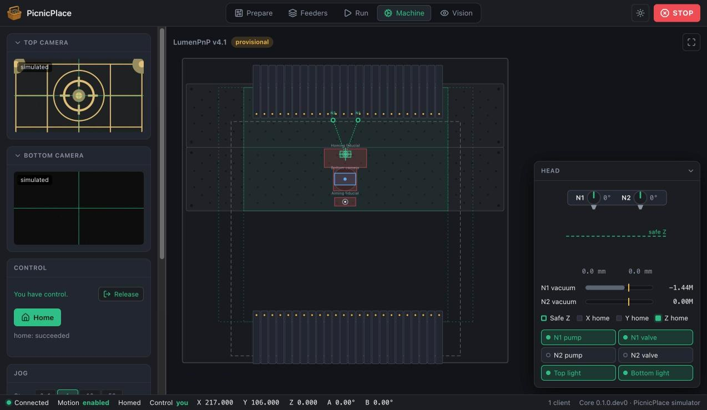

{ .pp-logo }

# PicnicPlace

An open source controller for PCB pick-and-place machines, built **network first**: a
headless core runs the machine, and every interface connects to it over a documented API.

[Try the simulator](guide/try-the-simulator.md){ .md-button .md-button--primary }
[Read the specification](SPEC.md){ .md-button }

!!! warning "Early development"

    PicnicPlace can't assemble a board yet. Manual control (homing, jogging, vacuum,
    cameras) and visual homing work against the built-in simulator; the first tests on a
    real LumenPnP are next. Follow along on
    [GitHub](https://github.com/mfarver/picnicplace).

{ .pp-screenshot }
/// caption
PicnicPlace Studio connected to the simulator: the machine map with staging plates, feeder
rails, and the area every nozzle can reach, live camera views, and the head with vacuum,
pumps, valves, and lights.
///

## Why PicnicPlace

-   **Network first**

    ---

    The core (`picnicd`) runs on the machine's computer. The Studio GUI, scripts, and
    your own tools connect over a versioned REST and WebSocket API. Closing a browser
    never stops a job.

-   **Safety in the core**

    ---

    Moves travel at safe Z, a physical safe-Z sensor is authoritative when the machine
    has one, only one client controls the machine at a time, and STOP works from
    anywhere.

-   **Vision built in**

    ---

    OpenCV-based fiducial finding, visual homing on the machine's datum, and camera
    calibration, with part alignment and board fiducials to come.

-   **Develop without a machine**

    ---

    A built-in simulator renders camera images from the machine's real geometry, and a
    fake Marlin firmware exercises the real driver, so most work needs no hardware.

-   **Machine profiles**

    ---

    One TOML file describes a machine: axes, nozzles, cameras, staging plates, keep-outs,
    and I/O. Where boards can go is computed from where every nozzle can reach.

-   **Open, and staying open**

    ---

    Licensed under the MPL-2.0: improvements to PicnicPlace stay open, while separate
    add-ons and API clients may use any license.

## Machines

The first machine is the **LumenPnP v4.1**, with a machine profile built from the
machine's published design files and real OpenPnP configurations. The **v4.2** has
its own profile, built on the v4.1's (its camera, datum, and discard tray are near the
left end of the front plate); it has not been run on a real v4.2 yet. A
[Quad 4c](SPEC.md#10-lumenpnp-target)
conversion is planned next, and the driver and profile design avoid LumenPnP-only
assumptions. See the [LumenPnP notes](hardware/lumenpnp-v4.md).

## Roadmap

| Milestone | Scope | Status |
|---|---|---|
| M0: Skeleton | Core, simulator, event socket, Studio shell | Done |
| M1: Manual control | Machine profiles, machine view, jogging, safe-Z interlock, control lease, Marlin driver, camera streams | Done, awaiting real-machine tests |
| M2: Calibration | Visual homing, camera scale, and discard and park locations set from the camera (done); lens calibration, nozzle offsets and runout, guided wizards | In progress |
| M3: Single placement | Parts library (with shared tapes, pin 1, and a tape preview), Photon feeders (discovery, part assignment, feeding, slots calibrated from feeder fiducials, pockets found from sprocket holes), pick, bottom-camera alignment, and place: done in the simulator, to be tried on a real machine | In progress |
| M4: Jobs | KiCad board and KiKit panel import, placing a job within every nozzle's reach, board fiducials, planner and dry run, running a whole job with pause, step, and skip, strips and trays on the bed, feeders rescanned and each one's fiducial found on its first pick in a run, picks kept centered by the top or the bottom camera or both (auto), and a flight recorder (done in the simulator); run history | In progress |
| M5: 1.0 | Packaging and user documentation; the operator app at the machine and the Creator, a website for preparing jobs (job revisions, accounts, house parts, problem reports), a calibration checklist, and parts counted on every reel and tray | Started: job revisions and job files, which runs run; the calibration checklist; the top and bottom cameras and the nozzle offsets calibrated; board and part heights found by touch; each nozzle's vacuum levels measured; heights and vacuum levels kept for each nozzle tip, and the fitted tip's size seen by the bottom camera; the setup wizard's calibration pages, with the machine limited until they are done |

## Get involved

PicnicPlace is written in Python (the core) and TypeScript with React (the Studio), on
Linux first, with macOS supported for development. Start with
[Contributing](contributing.md), and open an issue or a discussion on
[GitHub](https://github.com/mfarver/picnicplace).

<small>LumenPnP and Opulo are trademarks of Opulo. PicnicPlace is an independent project
and is not affiliated with or endorsed by Opulo.</small>
